<p align="center"></p>

<p align="center">
  <b>Laboratorio de Wireshark en el navegador: aprende a leer la red como un pentester con capturas de un ataque real en miniatura, filtros que se validan mientras escribes y retos guiados desde el saludo TCP hasta la inyección SQL, Kerberos y la caza en el SOC.</b>
</p>

<p align="center">
  <a href="https://heindall92.github.io/megalodon/"></a>
  <a href="megalodon.html"></a>
</p>

<p align="center">
  <a href="LICENSE"></a>
  
  
  
  
  <a href="https://github.com/heindall92/megalodon/actions/workflows/tests.yml"></a>
  
  
  
  
</p>

<p align="center">
  
</p>

Para leer tráfico con soltura hay que haber mirado muchas capturas, y las de verdad no explican nada ni dicen si lo has entendido. Megalodon reúne **8 capturas sintéticas (578 paquetes)** de un pentest de laboratorio sobre **tienda.ewpt.local** y la red de **MEGACORP** (inventadas) y te sienta delante de un espacio que se comporta como Wireshark. Con él practicas:

- filtros de visualización con la semántica de Wireshark 4.x, que se ponen verdes o rojos mientras escribes;
- el saludo TCP, HTTP, cookies y credenciales en claro, DNS y lo que TLS deja ver;
- ataques web en el tráfico: escaneo SYN, fuerza bruta, SQLi y XSS;
- Directorio Activo (Kerberos, SMB2 y NTLM) y caza en el SOC (ARP spoofing, beacon de C2 y exfiltración por DNS);
- las herramientas de analista: información experta, objetos HTTP, credenciales, seguir flujo, estadísticas, buscar e ir al paquete.

Son **32 lecciones y 58 retos** que se comprueban contra los paquetes al instante. Funciona en el navegador, sin servidor, sin cuenta y sin conexión: es **un solo archivo HTML**, y tu progreso no sale del equipo. Cada captura se exporta en `.pcapng` para repetir el reto en tu Wireshark de verdad.

<div align="center">

## `$ cat megalodon.yaml`

<table>
  <thead>
    <tr>
      <th colspan="2" align="left"><code>megalodon:~$ cat megalodon.yaml</code></th>
    </tr>
  </thead>
  <tbody>
    <tr>
      <td width="50%" valign="top"><code>├─ ◈ curso:</code><br><br>
        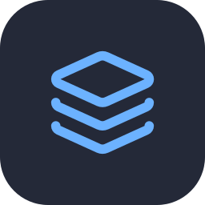
        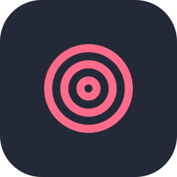
        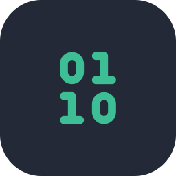
        <br>
        <sub><code>8 módulos · 32 lecciones · 58 retos · 60 «Pruébalo» · 578 paquetes · 136 campos · 41 términos</code></sub>
      </td>
      <td width="50%" valign="top"><code>├─ ⌕ analista:</code><br><br>
        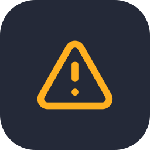
        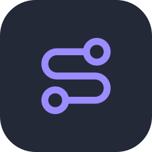
        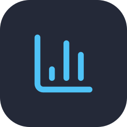<br>
        <sub><code>información experta · objetos HTTP · credenciales · seguir flujo TCP/UDP · conversaciones · endpoints · E/S</code></sub>
      </td>
    </tr>
    <tr>
      <td valign="top"><code>├─ ✦ aplicacion:</code><br><br>
        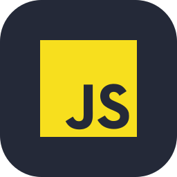
        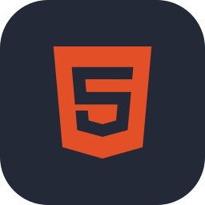
        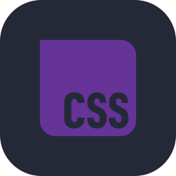
        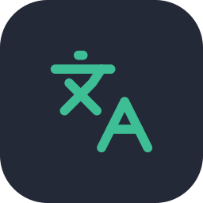
        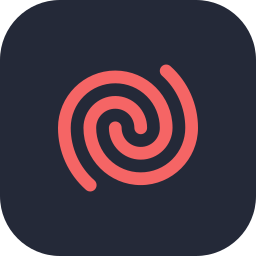<br>
        <sub><code>JavaScript · HTML · CSS · ES/EN · Lucide</code></sub>
      </td>
      <td valign="top"><code>├─ ⚙ build_ci_cd:</code><br><br>
        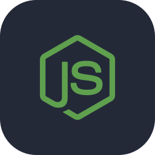
        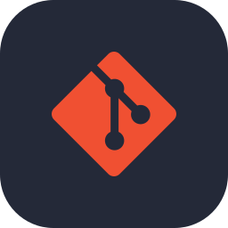
        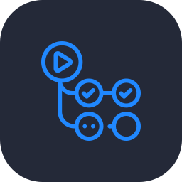
        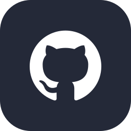<br>
        <sub><code>Node.js · Git · GitHub Actions · GitHub Pages</code></sub>
      </td>
    </tr>
    <tr>
      <td valign="top"><code>├─ ◉ pruebas:</code><br><br>
        
        
        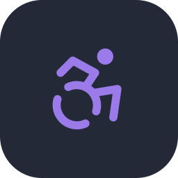<br>
        <sub><code>node:test 18 · Playwright 20 · axe-core 0 violaciones</code></sub>
      </td>
      <td valign="top"><code>╰─ ⌁ seguridad:</code><br><br>
        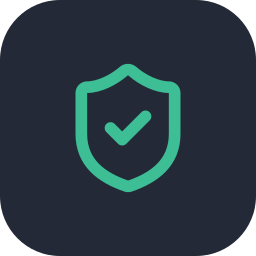
        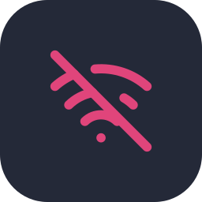<br>
        <sub><code>CSP con hashes · connect-src 'none' · cero peticiones de red</code></sub>
      </td>
    </tr>
  </tbody>
  <tfoot>
    <tr>
      <td colspan="2"><code>version: 1.3.1&nbsp;&nbsp;·&nbsp;&nbsp;filtros: Wireshark 4.x&nbsp;&nbsp;·&nbsp;&nbsp;pruebas: 38 ok&nbsp;&nbsp;·&nbsp;&nbsp;licencia: MIT</code></td>
    </tr>
  </tfoot>
</table>

</div>

---

##  Novedades

### 1.3.1 · noviembre de 2026 · Portada con la ilustración

- **Fuera el megalodón 3D.** La portada vuelve a la ilustración del megalodón como plano técnico azul, en mejor calidad (AVIF y WebP de 1983 px, unos 70 KB cada uno). La página pesa unos 100 KB menos y ya no necesita WebGL.
- **Encuadre.** Con la barra lateral, la portada es más estrecha: el tiburón queda a la derecha del título a 1280, 1440 y 1920 px, también con la barra plegada, y una prueba lo comprueba.

### 1.3.0 · noviembre de 2026 · Armazón nuevo y todo en inglés

- **Barra lateral a la izquierda**, como en BlueJr y RiskManager-Jr. Muestra los ocho módulos con su progreso: un punto gris si no lo has empezado, ámbar si está a medias y verde si está terminado, y los retos resueltos. Abajo van el nivel y la XP, y un indicador se desliza hasta la sección activa.
- **Se pliega** con el botón de la barra superior o con `[`, y recuerda el estado. Plegada queda un carril de iconos que se despliega por encima al pasar el ratón o al llegar con el teclado.
- **En el móvil, barra de pestañas abajo** (Inicio, Módulos, Laboratorio, Chuleta y Más). «Más» abre una hoja con Glosario, Ajustes, Ayuda y Atajos.
- **Interruptores de idioma (ES|EN) y de tema (claro|oscuro)** en la barra superior, con el mismo dibujo que en las demás herramientas. El pomo del tema se estira al pulsarlo.
- **Interfaz completa en inglés**. El árbol de detalle usa las etiquetas reales de Wireshark (`Frame 1: 77 bytes on wire`, `Sequence Number`, `Request Method`). También están en inglés los mensajes de los retos, los errores del filtro, los diálogos, la ayuda, los niveles y los títulos e insignias de los módulos. Una prueba recorre los 578 paquetes y falla si queda una etiqueta en español.

### 1.2.0 · noviembre de 2026 · Herramientas de analista

- **Información experta** (`E`), **objetos HTTP**, **credenciales**, **buscar paquete** (`Ctrl F`) por filtro, cadena o hex, **ir al paquete** (`Ctrl G`), **formato de tiempo**, **seguir flujo UDP** y **endpoints**.
- Cinco retos nuevos que obligan a usarlas, y un recorrido e2e que resuelve el curso entero desde la interfaz.

### 1.1.0 · noviembre de 2026 · El megalodón 3D

- Megalodón en tiempo real con **WebGL2 puro** en la portada, con la boca modelada según la anatomía documentada y el mordisco de Tricas (1985). Incluye la vista **Plano técnico** con cotas.
- Pruebas del motor, e2e con axe-core, CI y publicación en GitHub Pages.

### 1.0.0

- El laboratorio original: 8 módulos, capturas construidas byte a byte, filtros de visualización y retos.

## Índice

- [Novedades](#-novedades)
- [Cómo se usa](#-cómo-se-usa)
- [Mapa mental](#-mapa-mental)
- [Vistas](#-vistas)
- [Cómo se corrige](#-cómo-se-corrige)
- [Herramientas de analista](#-herramientas-de-analista)
- [Capturas](#-capturas)
- [Movimiento y diseño](#-movimiento-y-diseño)
- [Arranque rápido](#-arranque-rápido)
- [Arquitectura](#-arquitectura)
- [Privacidad y seguridad](#-privacidad-y-seguridad)
- [Pruebas](#-pruebas)
- [Hoja de ruta](#-hoja-de-ruta)
- [Limitaciones conocidas](#-limitaciones-conocidas)
- [Estructura](#-estructura)
- [Licencia](#-licencia)
- [Autor](#-autor)

---

##  Cómo se usa

1. **Elige un módulo** en la barra lateral (o en la barra de pestañas del móvil). Empieza por el 1 si nunca has abierto Wireshark.
2. **Lee la lección.** Es corta y trae botones «Pruébalo» que aplican el filtro en la captura. En el módulo 1, un diagrama de escalera anima el saludo TCP; cada flecha abre su paquete.
3. **Investiga en la captura.** Filtra, sigue flujos, abre la información experta o las estadísticas. La barra de filtros te dice al momento si el filtro es válido y, si no, por qué.
4. **Resuelve los retos.** Escribe el filtro, elige el paquete o responde. Si te atascas, tienes hasta tres pistas por reto.
5. **Llévatelo.** Exporta la captura en `.pcapng` o `.pcap`, completa o solo lo filtrado, y repite el reto en Wireshark. En el laboratorio libre puedes abrir tus propias capturas.

##  Mapa mental

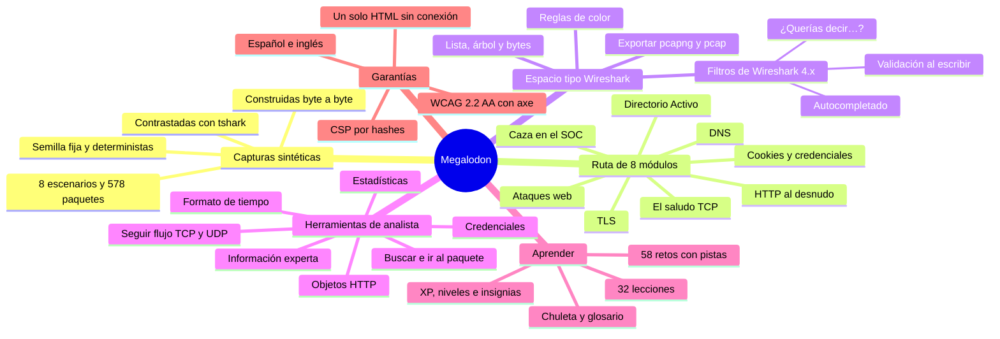

##  Vistas

| | Vista | Contenido |
|---|---|---|
|  | **Inicio** | Ilustración del megalodón, siguiente módulo recomendado, XP, nivel, retos resueltos, insignias, los ocho módulos y cómo funciona. |
|  | **Módulo** | Lección con «Pruébalo» y retos a la izquierda; captura del módulo a la derecha. En el móvil, pestañas Lección, Retos y Wireshark. |
|  | **Laboratorio libre** | Cualquiera de las ocho capturas, o la tuya en `.pcap` o `.pcapng` (arrastrándola o con «Abrir captura»). |
|  | **Chuleta** | Los filtros de uso diario, con copiar y probar en el laboratorio, y la tabla de los 136 campos. |
|  | **Glosario** | 41 términos de redes y pentesting, con buscador. |
|  | **Búsqueda** (`Ctrl K`) | Páginas, módulos, lecciones, retos, glosario, filtros, campos y acciones (tema, idioma, barra lateral). |
|  | **Ajustes, ayuda y atajos** | Tema, idioma, números de secuencia relativos, colores y borrar el progreso; guía de las tres zonas y de las herramientas; atajos (`?`). |

##  Cómo se corrige

Cada reto se comprueba contra la captura en el navegador, sin servidor:

| Tipo | Se da por bueno cuando… |
|---|---|
| **Filtro** | El filtro muestra exactamente los paquetes de la solución. Si no, te dice cuántos muestra, cuántos faltan y cuántos sobran, con un ejemplo. En algunos retos basta con cubrir un conjunto permitido. |
| **Paquete** | El paquete seleccionado cumple la condición del reto (por ejemplo, ser el `SYN, ACK` del saludo). |
| **Respuesta** | La respuesta coincide sin tener en cuenta mayúsculas ni tildes. Las contraseñas tienen que ser exactas, y las listas de números valen en cualquier orden. |
| **Test** | La opción es la correcta. Las fallidas se descartan. |

| Puntos | Valor |
|---|---|
| Reto sin pistas | 10 XP |
| Con 1, 2 o 3 pistas | 8, 6 o 5 XP |
| Módulo terminado | Insignia y 20 XP de bonus |
| Niveles | Alevín (0), Tintorera (80), Tiburón martillo (200), Gran blanco (380) y Megalodón (600) |

Una prueba resuelve cada reto con su solución de referencia contra su captura. Otra lo hace desde la interfaz, reto a reto, hasta ganar las 8 insignias.

##  Herramientas de analista

| | Herramienta | Comportamiento |
|---|---|---|
|  | **Filtros de visualización** | 136 campos con la semántica de Wireshark 4.x: `==` sobre cualquier valor, `in {80, 443}`, rangos, `contains`, `matches` y funciones. Autocompletado con `Tab`. Si el filtro falla, explica el error, marca su posición y sugiere el campo que quizá querías («¿Querías decir…?»). |
|  | **Información experta** (`E`) | Mensajes y severidades de Wireshark: `Connection reset (RST)` es *Warning* y `Connection establish request (SYN)` es *Chat*. Salta a cada paquete y permite filtrarlos. |
|  | **Objetos HTTP** | Cuerpos reconstruidos con host, tipo, tamaño y nombre seguro. La vista previa muestra texto (nunca interpreta el HTML de la captura) y permite descargar. |
|  | **Credenciales** | HTTP Basic, FTP y NTLMSSP, con salto al campo exacto del árbol. |
|  | **Seguir flujo** (`F`) | TCP o UDP según el paquete, con cliente y servidor en colores y paso al flujo anterior o siguiente. |
|  | **Estadísticas** (`S`) | Conversaciones (Ethernet, IPv4, TCP, UDP), endpoints IPv4, jerarquía de protocolos y gráfico de E/S que compara el filtro con el total. |
|  | **Buscar e ir al paquete** | `Ctrl F` busca por filtro, cadena o hex desde el paquete seleccionado y da la vuelta al llegar al final. `Ctrl G` lleva al paquete y avisa si el filtro lo oculta. |
|  | **Formato de tiempo** | Desde el inicio, desde el anterior capturado, desde el anterior mostrado u hora UTC. Con «desde el anterior mostrado» el beacon de 60 s del módulo 8 salta a la vista. |

##  Capturas

<table>
<tr>
<td width="50%"><br/><sub><b>Módulo 1</b> · lección con diagrama de escalera y Wireshark al lado</sub></td>
<td width="50%">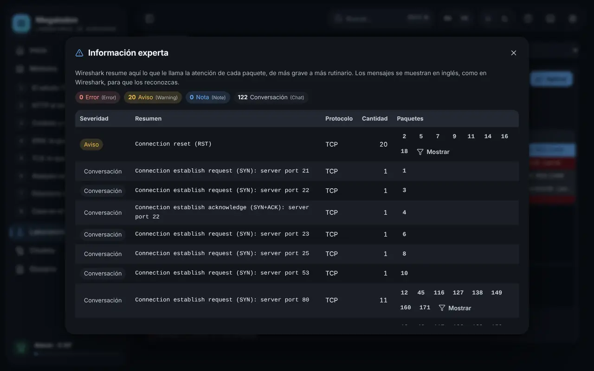<br/><sub><b>Información experta</b> · avisos y severidades del módulo 6</sub></td>
</tr>
<tr>
<td>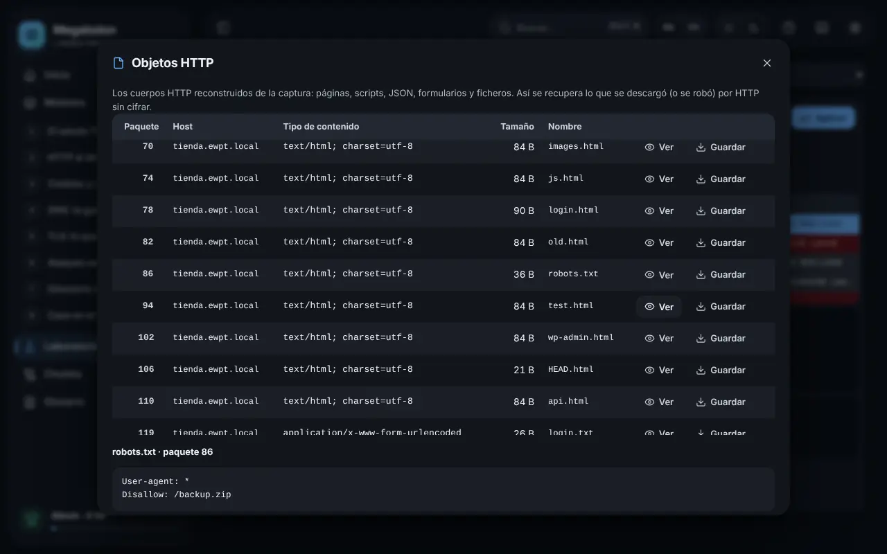<br/><sub><b>Objetos HTTP</b> · el robots.txt que delata la copia de seguridad</sub></td>
<td>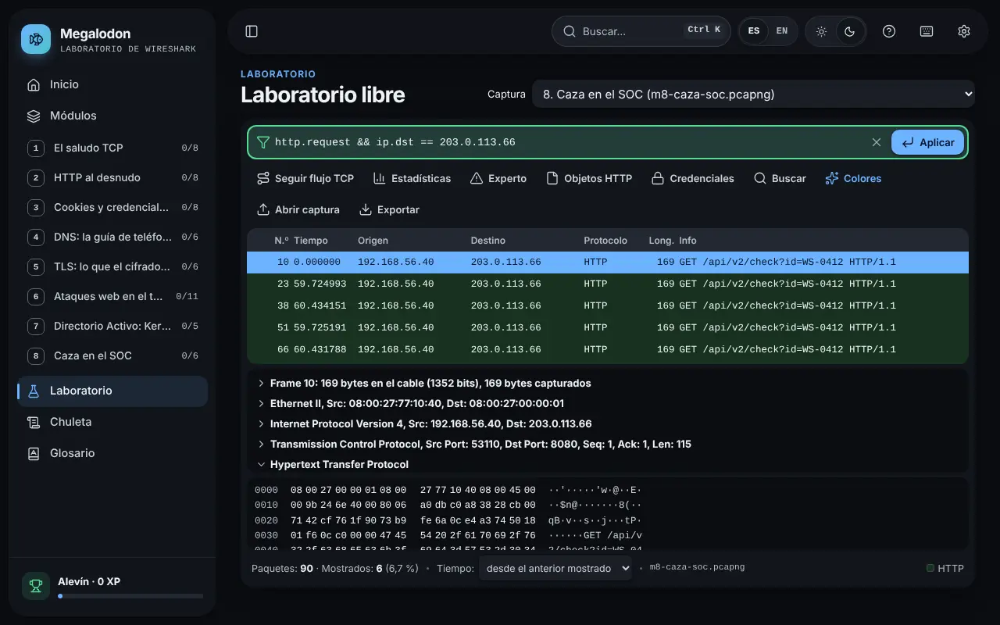<br/><sub><b>Beacon de C2</b> · «desde el anterior mostrado» marca los 60 s</sub></td>
</tr>
<tr>
<td>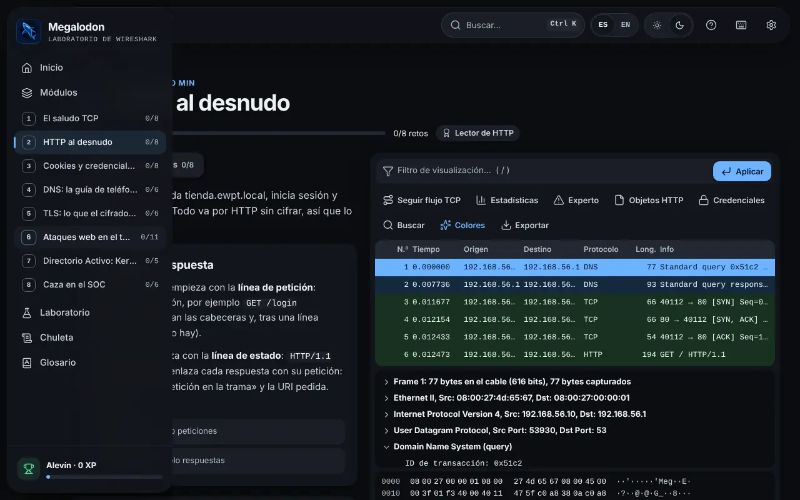<br/><sub><b>Barra lateral plegada</b> · el carril se despliega por encima al pasar el ratón</sub></td>
<td>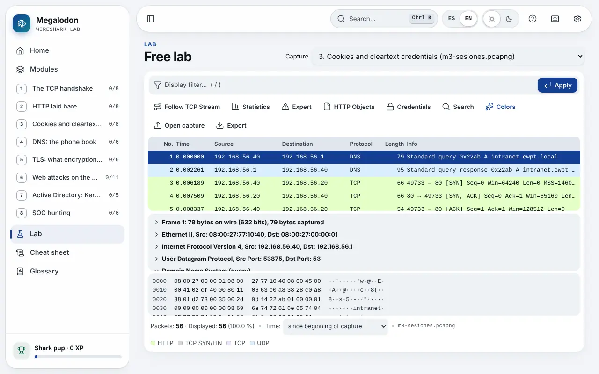<br/><sub><b>Inglés y modo claro</b> · interruptores ES|EN y claro|oscuro</sub></td>
</tr>
<tr>
<td colspan="2"><br/><sub><b>Inicio en modo claro</b> · progreso, módulos y cómo funciona</sub></td>
</tr>
</table>

<p align="center">
  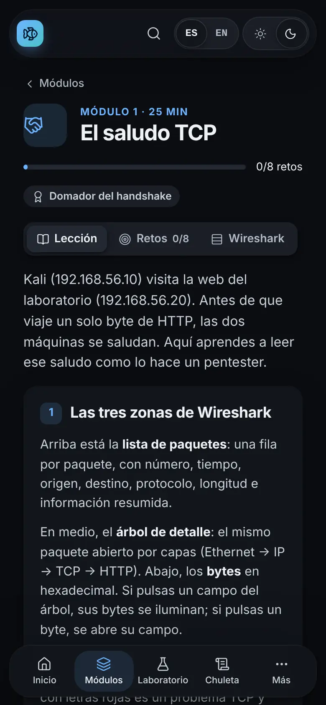
  &nbsp;&nbsp;
  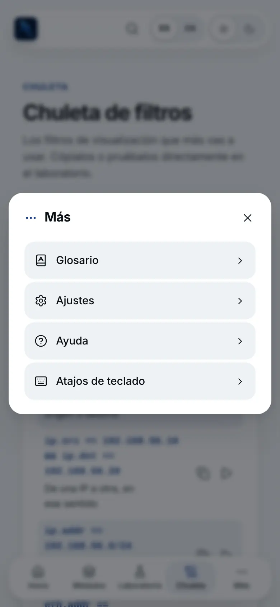
  &nbsp;&nbsp;
  
  <br/><sub><b>Móvil</b> · barra de pestañas abajo y hoja «Más» con glosario, ajustes, ayuda y atajos</sub>
</p>

##  Movimiento y diseño

Siguiendo los principios de Emil Kowalski y el diseño de Apple:

| Pieza | Comportamiento |
|---|---|
| Barra lateral | Se pliega en 320 ms con la curva de cajón de iOS (`cubic-bezier(0.32, 0.72, 0, 1)`). Plegada, se despliega por encima sin mover el contenido. El indicador de la sección activa se desliza en 340 ms. |
| Entrada del lateral | Los elementos entran escalonados 25 ms (300 ms cada uno), solo en la primera carga. |
| Interruptor de tema | El pomo se desliza en 280 ms y se estira al pulsarlo, como en iOS. Al cambiar de tema, los colores se funden en 300 ms. |
| Botones | Se hunden al pulsarlos, entre el 94 % y el 98,5 % de su tamaño según la pieza (los pequeños, más). |
| Cambio de vista | El contenido entra en 240 ms con `ease-out`. |
| Nivel y XP | El nivel da un pequeño salto con muelle (450 ms) cada vez que sumas XP. |
| Portada | La ilustración se acerca muy despacio (36 s, ida y vuelta) para dar profundidad. |
| Movimiento reducido | Sin desplazamientos ni bucles. Las transiciones del lateral y del tema son instantáneas, y la ilustración de la portada queda quieta. |

Oscuro casi negro frío (`#0b0d11` / `#12151b`) o claro gris perla (`#f3f5f8` / `#ffffff`), con un solo acento azul (`#6cb2ff` en oscuro y `#143f94` en claro). Tipografía del sistema (SF Pro en Apple) y monoespaciada del sistema para paquetes, bytes y filtros. Iconos solo de **Lucide**.

##  Arranque rápido

**En línea:** [heindall92.github.io/megalodon](https://heindall92.github.io/megalodon/). Se publica con cada cambio en `main`.

**En local, sin instalar nada:** descarga [`megalodon.html`](megalodon.html) y ábrelo en el navegador. Es la aplicación completa en un fichero.

**Para desarrollar** (Node.js 20 o superior):

```bash
git clone https://github.com/heindall92/megalodon.git
cd megalodon
npm install            # Playwright y axe-core, solo para las pruebas
npm run build          # src/ → dist/index.html y megalodon.html
./run_tests.sh         # compilación al día, motor, idioma y e2e con axe
```

| Comando | Qué hace |
|---|---|
| `npm run build` | Genera `dist/index.html` y `megalodon.html` (idénticos) con la CSP calculada. |
| `node scripts/build.mjs --check` | Falla si los HTML no corresponden a `src/` (lo usa la CI). |
| `npm run test:engine` | Motor e idioma (`node:test`, sin navegador). |
| `npm run test:e2e` | Aplicación en Chromium: curso completo, herramientas, armazón, CSP y accesibilidad. |
| `npm test` | Todo lo anterior. |
| `node scripts/capturas.mjs` | Regenera las capturas de este README a partir de `dist/`. |

##  Arquitectura

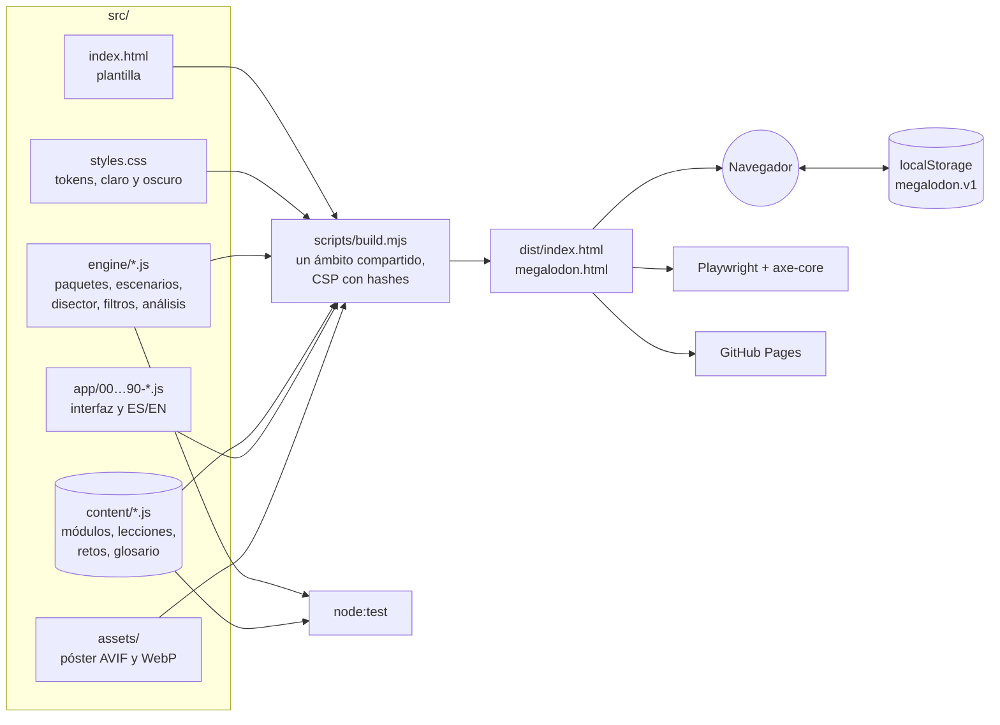

- **Sin framework ni dependencias en ejecución.** JavaScript sin compilar, concatenado en orden en un solo ámbito.
- **Motor independiente de la interfaz.** Los constructores de paquetes, el disector, los filtros, las estadísticas y el análisis no tocan el DOM. Las pruebas los cargan en Node con el mismo ámbito que el navegador.
- **Capturas deterministas.** Con la semilla fija, los retos se comprueban contra los mismos bytes en el navegador, en las pruebas y en el `.pcapng` exportado.
- **Idioma en la capa de presentación.** El motor genera sus textos en español. La interfaz traduce los errores del filtro y las etiquetas del árbol, y una prueba garantiza que no se escapa ninguno.

##  Privacidad y seguridad

- **Un único HTML autocontenido.** Sin CDN, sin fuentes externas, sin analítica y sin peticiones de red.
- **CSP** generada en el build: `default-src 'none'`, `script-src` y `style-src` solo por hash, `connect-src 'none'`. La compilación falla si el HTML carga algo externo, y las e2e bloquean cualquier petición que no sea `file:`, `data:` o `blob:`.
- **El contenido de las capturas se trata como texto.** Toda salida al DOM pasa por `esc()`. Los objetos HTTP se previsualizan con `textContent`, nunca como HTML.
- **Tus capturas no salen del equipo.** Los `.pcap` y `.pcapng` que abres se leen en el navegador, con un límite de 64 MB.
- **Progreso local.** Solo se guarda en `localStorage`, con la clave `megalodon.v1`.
- **Capturas sintéticas.** Usan direcciones de laboratorio y dominios de prueba. Ver [SECURITY.md](SECURITY.md).

##  Pruebas

| Suite | Pruebas | Qué comprueba |
|---|---|---|
| Motor (`engine.test.mjs`) | 13 | Las 8 capturas se generan, se disecan y son deterministas. Exportar a pcap/pcapng y releer conserva cada byte. **Los 58 retos tienen solución comprobable** contra su captura, y las respuestas derivadas (avisos, intervalo del beacon, Base64 exfiltrado, firma ZIP) se recalculan desde los paquetes. Los 60 «Pruébalo» compilan y muestran paquetes. También comprueba la sintaxis de filtros de Wireshark 4.x, la información experta, los objetos HTTP, las credenciales, el flujo UDP y el checksum RFC 1071. |
| Idioma (`i18n.test.mjs`) | 5 | Español e inglés tienen las mismas claves. Los ocho módulos tienen título, subtítulo e insignia en inglés. **Cada error del motor de filtros** y **cada etiqueta del árbol de detalle de los 578 paquetes** están traducidos, sin restos en español. |
| E2E (`e2e.mjs`) | 20 | **El curso completo se resuelve desde la interfaz** (58 retos y 8 insignias). También cubre: <ul><li>herramientas de analista, buscar e ir al paquete, formato de tiempo y flujo UDP;</li><li>búsqueda `Ctrl K`;</li><li>portada: la ilustración carga, el tiburón queda a la derecha del título a 1280, 1440 y 1920 px (también con la barra plegada) y se queda quieta con movimiento reducido;</li><li>barra lateral plegable (`[`, ratón y estado guardado);</li><li>interruptores de idioma y de tema;</li><li>móvil con la hoja «Más»;</li><li>CSP estricta y red bloqueada.</li></ul> |
| Accesibilidad (dentro de `e2e.mjs`) | — | axe-core (WCAG 2.2 A/AA) da **cero violaciones** en: <ul><li>6 vistas, a 1280 y 390 px, en claro y oscuro;</li><li>los diálogos de análisis;</li><li>la barra lateral plegada;</li><li>la interfaz en inglés;</li><li>la hoja «Más».</li></ul> |

La [integración continua](.github/workflows/tests.yml) ejecuta todo en cada *push* y *pull request* y comprueba que los HTML están al día.

##  Hoja de ruta

Detalle en [ROADMAP.md](ROADMAP.md).

- [x] 1.0.0 · El laboratorio: 8 módulos, capturas byte a byte, filtros y retos
- [x] 1.1.0 · Megalodón 3D, pruebas, CI y GitHub Pages
- [x] 1.2.0 · Herramientas de analista y recorrido del curso completo
- [x] 1.3.0 · Barra lateral plegable, barra de pestañas en el móvil, interruptores e interfaz en inglés
- [x] 1.3.1 · Portada con la ilustración del megalodón y sin el 3D
- [ ] 1.3.x · Lecciones, retos, glosario y campos en inglés, revisados a mano
- [ ] 1.4.0 · Más capturas: SMB y movimiento lateral, VoIP/SIP y DHCP spoofing

##  Limitaciones conocidas

- **Contenido en español.** La interfaz está entera en inglés, con el árbol de detalle con las etiquetas de Wireshark. Pero las lecciones, los enunciados, las pistas, el glosario y las descripciones de los campos siguen en español, y la interfaz lo avisa.
- **Subconjunto de Wireshark.** Hay 136 campos y los protocolos de las capturas del curso. Una captura propia con otros protocolos se ve hasta la capa que el disector conoce.
- **Sin captura en vivo.** El navegador no puede escuchar la interfaz de red; para eso está Wireshark.
- **El progreso vive en el navegador.** Si borras sus datos, se pierde.

##  Estructura

```
megalodon/
│
├── 🧩 src/
│   ├── index.html              Plantilla
│   ├── styles.css              Tokens, claro y oscuro, barra lateral, móvil y movimiento
│   ├── engine/                 Motor sin DOM
│   │   ├── net.js              Constructores de tramas y checksums
│   │   ├── scenarios.js        Las 8 capturas, con semilla fija
│   │   ├── fields.js           136 campos de filtro
│   │   ├── dissect.js          Disector, árbol de detalle y rangos de bytes
│   │   ├── filter.js           Filtros de visualización y autocompletado
│   │   ├── stats.js            Conversaciones, endpoints, jerarquía, E/S y flujos
│   │   └── analyze.js          Información experta, objetos HTTP, credenciales y flujo UDP
│   ├── content/                Módulos, lecciones y retos; chuleta, glosario y atajos
│   ├── app/                    Interfaz
│   │   ├── 00-iconos.js        Iconos Lucide en línea
│   │   ├── 05-i18n.js          Textos en español e inglés
│   │   ├── 10-state.js         Progreso, XP, niveles e insignias
│   │   ├── 20-ui.js            Diálogos, avisos y portapapeles
│   │   ├── 30-workspace.js     Espacio tipo Wireshark y árbol en inglés
│   │   ├── 40-dialogs.js       Seguir flujo, estadísticas y herramientas de analista
│   │   ├── 45-ladder.js        Diagrama de escalera del saludo TCP
│   │   ├── 50-views.js         Inicio, módulos, laboratorio, chuleta y glosario
│   │   └── 90-shell.js         Barra lateral, barra superior, pestañas, búsqueda y ajustes
│   └── assets/                 Ilustración de la portada (AVIF y WebP)
│
├── 📦 dist/index.html          La aplicación generada (igual que megalodon.html)
├── 🛠️ scripts/                  build.mjs · capturas.mjs
├── 🧪 tests/                    engine · i18n · e2e · load
├── 📄 docs/                     Capturas, cabecera e iconos del README
└── ⚙️ .github/workflows/        tests.yml · pages.yml
```

##  Licencia

Distribuido bajo licencia [MIT](LICENSE) · © 2026 Yoandy Ramírez Delgado.

Megalodon es un proyecto independiente, sin relación con la Wireshark Foundation ni con INE/eLearnSecurity (eWPT). Wireshark es una marca de la Wireshark Foundation. El contenido es de redacción propia y se apoya en la [documentación pública de Wireshark](https://www.wireshark.org/docs/).

Componentes de terceros:

- iconos de [Lucide](https://lucide.dev) (ISC);
- logotipos de [Simple Icons](https://simpleicons.org) (CC0) en la tabla `megalodon.yaml`, cuyas marcas pertenecen a sus titulares;
- [Playwright](https://playwright.dev) y [axe-core](https://github.com/dequelabs/axe-core), solo para las pruebas.

##  Autor

<table>
<tr>
<td align="center" width="100%" valign="top">
<br/>
<b>Yoandy Ramírez Delgado</b><br/>
<sub><b>Diseño y desarrollo de Megalodon</b></sub><br/>
<sub>Junior Pentester · eJPTv2 · AI Governance (ISO 42001) · SysAdmin</sub><br/><br/>
<a href="https://www.linkedin.com/in/yoandyrd92/"></a>
<a href="https://github.com/heindall92"></a>
<a href="https://yoandyramirez.com"></a>
<a href="https://profile.hackthebox.com/profile/019c5812-b4ca-7315-b12f-14db6d2b42fa"></a>
</td>
</tr>
</table>

Otras herramientas del autor:

- [Blue-Jr](https://github.com/heindall92/Blue-Jr): simulador de SOC de nivel 1.
- [WhiteFox](https://github.com/heindall92/WhiteFox): laboratorio de Nessus.
- [RiskManager-Jr](https://github.com/heindall92/RiskManager-Jr): auditar IA y SaaS.
- [Rosetta](https://github.com/heindall92/rosetta_multinorma): mapa multinorma.
- [CTEM-Nexus](https://github.com/heindall92/ctem-nexus): exposición y rutas de ataque.
- [Astrolabio](https://github.com/heindall92/astrolabio): entrevistas con el método STAR.

Para errores o propuestas, abre una *issue* o escribe a <a href="mailto:yoandyramirezdelgado@gmail.com">yoandyramirezdelgado@gmail.com</a>.

<p align="center">
  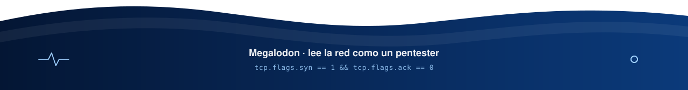
</p>
