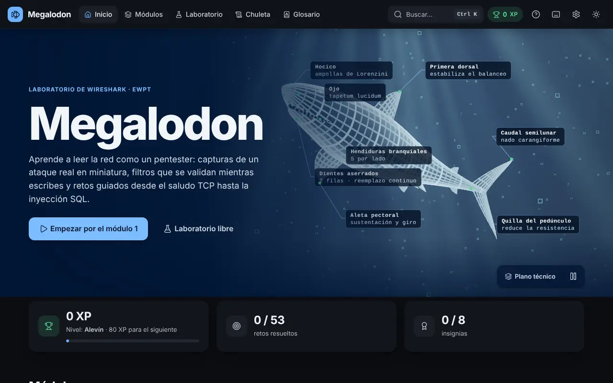
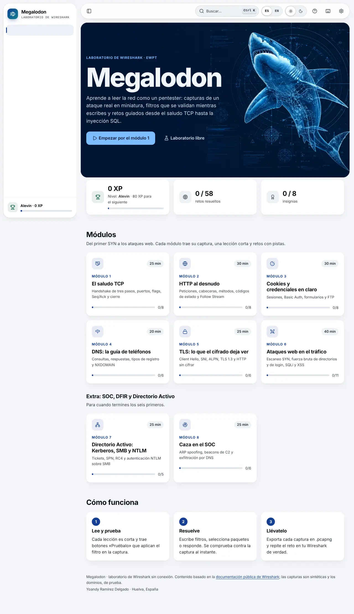

# Megalodon · Laboratorio de Wireshark

Aprende a leer la red como un pentester sin instalar nada: capturas sintéticas de un ataque real en miniatura, filtros de visualización que se validan mientras escribes y retos guiados desde el saludo TCP hasta la inyección SQL, Kerberos y la caza en el SOC.

**Demo:** https://heindall92.github.io/megalodon/ · o descarga [`megalodon.html`](megalodon.html) y ábrelo en el navegador. Funciona sin conexión, sin cuenta y sin servidor.


## Qué trae

| | |
|---|---|
| **8 módulos** | Saludo TCP, HTTP, cookies y credenciales, DNS, TLS, ataques web, Directorio Activo (Kerberos, SMB2, NTLM) y caza en el SOC (ARP spoofing, beacon de C2, exfiltración por DNS) |
| **32 lecciones · 58 retos** | Escribir filtros, seleccionar paquetes, responder y tests. Cada reto tiene pistas y se comprueba contra la captura al instante |
| **8 capturas, 578 paquetes** | Construidas byte a byte (Ethernet, ARP, IPv4, ICMP, UDP, TCP, DNS, DHCP, HTTP, TLS, SMB2, NTLMSSP, Kerberos v5) con semilla fija: siempre idénticas |
| **Espacio tipo Wireshark** | Lista virtualizada, árbol de detalle con rangos de bytes, volcado hexadecimal, reglas de color, Seguir flujo TCP y UDP, estadísticas (conversaciones, endpoints, jerarquía, E/S) y diagrama de escalera |
| **Herramientas de analista** | Información experta con los mensajes y severidades de Wireshark, Exportar objetos HTTP (ver y guardar), Credenciales (HTTP Basic, FTP, NTLMSSP), Buscar paquete por filtro, cadena o hex (`Ctrl F`), Ir al paquete (`Ctrl G`) y formato de tiempo (desde el inicio, desde el anterior capturado o mostrado, hora UTC) |
| **Filtros de visualización** | 136 campos con la semántica de Wireshark 4.x (`==` sobre cualquier valor, `in {80, 443}`, rangos, `contains`, `matches`, funciones), errores en español con posición y «¿Querías decir…?» |
| **Exportar** | Cada captura en `.pcapng` para repetir el reto en tu Wireshark de verdad; también lee `.pcap` y `.pcapng` |
| **Chuleta y glosario** | 41 términos y los filtros de uso diario, con búsqueda global `Ctrl K` |

## Herramientas de analista

| Información experta | Objetos HTTP |
|---|---|
|  |  |


Las mismas funciones que usa un pentester o un analista de SOC en Wireshark, con su comportamiento real:

- **Información experta** (`E`): mensajes en inglés tal como los emite Wireshark y su severidad (por ejemplo, `Connection reset (RST)` es *Warning* y `Connection establish request (SYN): server port 80` es *Chat*), con salto a cada paquete y botón para filtrarlos.
- **Objetos HTTP**: cada cuerpo reconstruido con host, tipo, tamaño y nombre seguro; vista previa como texto (nunca se interpreta el HTML de la captura) y descarga.
- **Credenciales**: paquete, protocolo, usuario e información, y salto al campo exacto del árbol.
- **Buscar** por filtro, cadena o hex desde el paquete seleccionado y dando la vuelta, como Wireshark; **Ir al paquete** avisa si el paquete está oculto por el filtro.
- **Formato de tiempo**: con «desde el anterior mostrado» el intervalo de un beacon salta a la vista (60 s en el módulo 8).

Cinco retos nuevos obligan a usarlas: los avisos de la información experta, el fichero que esconde `robots.txt`, la firma ZIP `50 4b 03 04` buscada en hexadecimal, el intervalo del beacon y la contraseña exfiltrada por DNS en Base64.

## El megalodón 3D

El hero de inicio es un megalodón en tiempo real hecho con **WebGL2 puro**, sin librerías ni modelos externos: toda la malla (≈ 60 000 vértices) se genera con código.

| Boca abierta | Protrusión de la mandíbula superior |
|---|---|
|  |  |

- **Boca documentada:** dos arcos en herradura con banda de encía, 13 dientes superiores anchos y 12 inferiores estrechos por lado, el intermedio superior más pequeño, inclinación distal creciente y una fila de reemplazo tumbada detrás.
- **Mordisco real a cámara lenta:** elevación del hocico y descenso de la mandíbula, protrusión del palatocuadrado al cerrar, sacudida lateral y bajada del hocico, con los tiempos de Tricas (1985). El ojo rota hacia atrás mientras muerde.
- **Piel y agua:** contrasombreado irregular, dentículos, branquias, ampollas de Lorenzini y cicatrices; cáusticas, absorción del agua por canal, rayos de luz con la sombra del tiburón, nieve marina y bloom.
- **Plano técnico:** un escaneo de la cabeza a la cola convierte el modelo en plano con cotas anatómicas que siguen al animal mientras nada.



Fuentes y decisiones de modelado en [docs/megalodon-3d.md](docs/megalodon-3d.md). Sin WebGL2 se muestra el póster original; con «reducir movimiento» se ve un fotograma fijo con la boca abierta y un botón para animarlo.

| Claro | Móvil | Módulo 1 |
|---|---|---|
|  |  |  |

## Privacidad y seguridad

- Un único HTML autocontenido. Sin CDN, sin fuentes externas, sin analítica, sin peticiones de red.
- CSP estricta por hashes: `default-src 'none'`, `script-src` y `style-src` con los `sha256` del código incrustado, `connect-src 'none'`. La compilación falla si el HTML carga algo externo y las e2e bloquean cualquier petición que no sea `file:`, `data:` o `blob:`.
- El progreso se guarda solo en tu navegador (`localStorage`, clave `megalodon.v1`).
- Las capturas son sintéticas: direcciones de laboratorio y dominios de prueba. Ver [SECURITY.md](SECURITY.md).

## Desarrollo

```bash
npm install          # Playwright y axe-core, solo para las pruebas
npm run build        # src/ → dist/index.html y megalodon.html
./run_tests.sh       # compilación al día, motor y e2e con axe
```

| Carpeta | Contenido |
|---|---|
| `src/engine/` | Motor sin DOM: constructores de paquetes, escenarios, disector, filtros y estadísticas |
| `src/content/` | Módulos, lecciones, retos, chuleta y glosario |
| `src/app/` | Interfaz: estado, espacio de trabajo, diálogos, diagrama de escalera, megalodón 3D, vistas y armazón |
| `scripts/build.mjs` | Concatena en un ámbito compartido, incrusta CSS y JS y calcula la CSP |

## Pruebas

- **Motor (13 pruebas, `node --test`):** las 8 capturas se generan y disecan; son deterministas; exportar a pcap/pcapng y releer conserva cada byte; **los 58 retos tienen solución comprobable** contra su captura y las respuestas derivadas (avisos, intervalo del beacon, Base64 exfiltrado, firma ZIP) se recalculan desde los paquetes; los 60 botones «Pruébalo» compilan y muestran paquetes; sintaxis de filtros de Wireshark 4.x; información experta, objetos HTTP, credenciales y flujo UDP; checksum RFC 1071.
- **E2E (17 pruebas, Chromium real):** **el curso completo se resuelve desde la interfaz** (58 retos y 8 insignias); herramientas de analista; CSP; megalodón 3D; búsqueda `Ctrl K`; y **axe-core con 0 infracciones WCAG 2.2 AA** en 6 vistas y en los diálogos nuevos, a 1280 y 390 px, en oscuro y claro.

## Avisos

Megalodon es un proyecto independiente, sin relación con la Wireshark Foundation ni con INE/eLearnSecurity (eWPT). Wireshark es una marca de la Wireshark Foundation. El contenido es de redacción propia y se apoya en la [documentación pública de Wireshark](https://www.wireshark.org/docs/). Iconos de [Lucide](https://lucide.dev) (ISC).

## Licencia y autor

MIT · Yoandy Ramírez Delgado · Huelva, España
